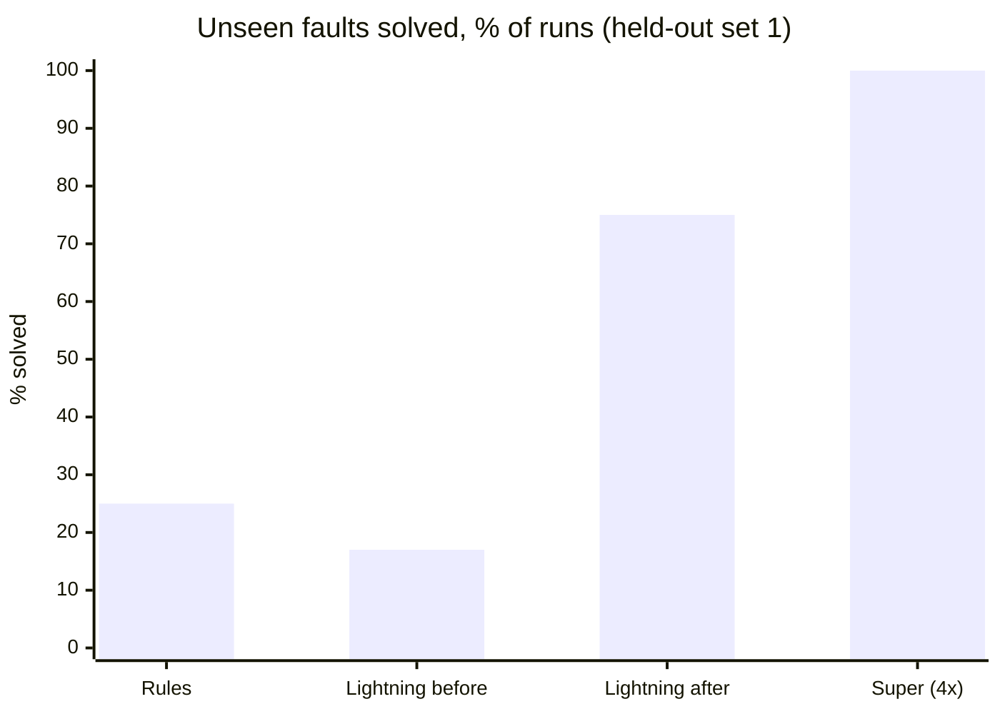
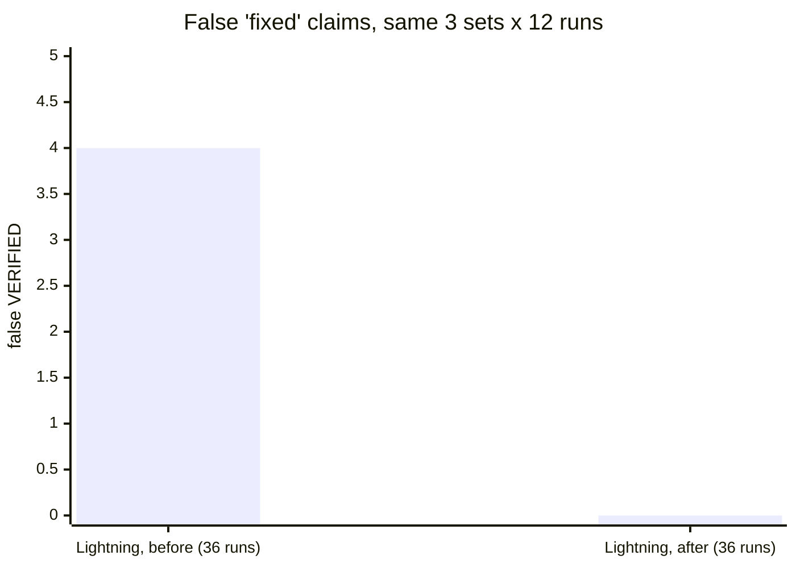
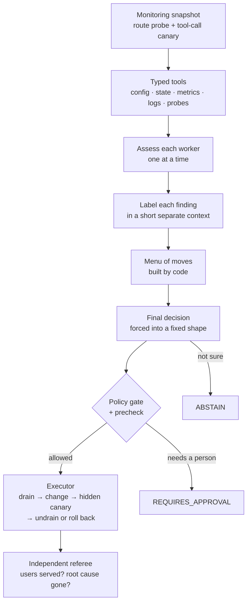

# Nexus Ω

**We made a small model trustworthy enough to touch production.**

Nexus Ω is a repair loop for self-hosted AI inference. A 3B-active NVIDIA Nemotron 3.5 Lightning agent investigates a live vLLM fleet through typed tools and proposes one fix. Code checks the fix, applies it with an undo path, and an independent referee decides whether it worked. The model never grades its own work.

> **0** false "fixed" claims in 36 runs · **9/12 vs 3/12** for hand-written rules on faults nobody wrote rules for · tool calling **0.83 → 0.00** under a silent fault that every health check misses

NVIDIA × Red Hat Small Models Hack, Raleigh, October 17–18, 2026 · **Track: Tool-Calling** · Bounties: **Best use of Nemotron Lightning**, **Best use of Red Hat vLLM**

---

## In 30 seconds

**The problem.** Teams run their own models on vLLM to power AI agents. One wrong serving setting, such as a tool parser that doesn't match the model, and the server keeps answering HTTP 200, fast, with every health check green, while the tool calls the agents depend on are silently gone. We measured it: the tool-calling score of the same model on the same GPU drops from 0.83 to 0.00, and no alert fires.

**What we built.** A real two-worker vLLM fleet on one NVIDIA Brev H100. We can break it on purpose: dropped tool calls, killed workers, slow or cut network links, overload. On the same GPU, Nemotron 3.5 Lightning looks around through typed tools and proposes one fix. A policy gate checks it, an executor applies it (drain → change → hidden test → undrain, or roll back), and a referee outside the model's control decides whether users are served and the root cause is gone.

**What we found.** Out of the box, the small model sometimes said "fixed" when nothing was: 4 times in 36 runs. We didn't swap in a bigger model. We redesigned the harness around the same weights, and on 36 new runs it made **zero** false "fixed" claims. On faults nobody wrote rules for, it now solves **9 of 12** where hand-written rules solve 3. A model with 4× the active parameters, on the same harness, solves 11 of 11, but it takes about twice as long and can't run on the GPU it repairs.

## Results

Every number below is rebuilt from the records in [`evidence/`](evidence/) by the same code that serves the website ([`nexus/results/store.py`](nexus/results/store.py), batches in [`evidence/batches.json`](evidence/batches.json)). The full log, including every failed attempt, is in [`evidence/agent/README.md`](evidence/agent/README.md).

### Faults nobody wrote rules for (held-out set 1)



Rules 3/12 · Lightning before 2/12 · **Lightning after 9/12** · Super 11/11 valid (a reference run, not part of the product).

### False "fixed" claims: the number that matters

A smoke detector that sometimes misses a fire is a problem. One that says the fire is out while the kitchen is still burning is far worse, because everyone stops looking. That's a **false VERIFIED**: the agent claims a repair worked and the referee finds it didn't.



### Every fault, every run

One icon per run, as the referee scored it: ✅ solved · ⬜ honest miss (asked a human or stepped back, never claimed a fix) · ❌ false "fixed" · `·` not run.

| Fault | Rules | Lightning before | Lightning after | Super 120B (ref) |
|---|---|---|---|---|
| **Faults we wrote rules for** | | | | |
| Tool calls silently dropped (wrong parser, vLLM #32926) <br><sub>`vllm-32926`</sub> | ✅✅✅ | ✅✅✅ | ✅✅✅ | · |
| Slow network link to a worker <br><sub>`net-latency-b`</sub> | ✅✅✅ | ✅❌❌ | ✅✅✅ | · |
| Network link to a worker cut <br><sub>`net-blackhole-b`</sub> | ✅✅✅ | ✅❌✅ | ✅✅✅ | · |
| Worker killed <br><sub>`kill-b`</sub> | ✅✅✅ | ⬜⬜✅ | ⬜✅✅ | · |
| *Total* | *12/12* | *7/12* | ***11/12*** | · |
| **New faults, set 1 (held-out v1)** | | | | |
| Two faults at once (slow link + dropped tool calls) <br><sub>`compound-latb-32926a`</sub> | ⬜⬜⬜ | ⬜⬜⬜ | ✅⬜✅ | ✅✅ |
| Worker choked under load <br><sub>`capacity-b`</sub> | ⬜⬜⬜ | ⬜⬜⬜ | ⬜⬜✅ | ✅✅✅ |
| Tools silently ignored (template drops them) <br><sub>`tools-stripped-a`</sub> | ⬜⬜⬜ | ⬜⬜✅ | ✅✅✅ | ✅✅✅ |
| Nothing wrong (right answer: change nothing) <br><sub>`noop`</sub> | ✅✅✅ | ❌✅⬜ | ✅✅✅ | ✅✅✅ |
| *Total* | *3/12* | *2/12* | ***9/12*** | *11/11* |
| **New faults, set 2 (held-out v2)** | | | | |
| Tool calling switched off (HTTP 400) <br><sub>`noauto-a`</sub> | ✅✅✅ | ✅✅✅ | ✅✅✅ | · |
| Tool calls dropped, other worker <br><sub>`vllm-32926-b`</sub> | ✅✅✅ | ✅✅✅ | ✅✅✅ | · |
| Other worker killed <br><sub>`kill-a`</sub> | ✅✅✅ | ⬜✅⬜ | ✅✅✅ | · |
| Crash plus dropped tool calls <br><sub>`compound-killb-32926a`</sub> | ✅✅✅ | ✅✅✅ | ✅✅✅ | · |
| *Total* | *12/12* | *10/12* | ***12/12*** | · |

How to read it:
- The rules are perfect on the faults they were written for, and fall apart on new ones.
- The redesigned agent is right on 32 of 36 runs, and its 4 misses are all honest: it asked a human or stepped back instead of claiming a fix.

### Would a bigger model do better?

Same structured harness, fleet and referee on held-out set 1; only the model endpoint changes.

| | Nemotron 3.5 Lightning | Nemotron 3 Super |
|---|---|---|
| Size | 30B total · **3B active** | 120B total · 12B active |
| Unseen faults solved | 9/12 | 11/11 valid |
| False "fixed" claims | **0** | **0** |
| Median time per incident | **95 s** | 202 s (includes hosted-API network time) |
| Where it runs | On the same H100 as the fleet it repairs, 35% of its memory | Hosted API, off the box |

**Reading.** The harness took Lightning from 2/12 to 9/12; the bigger model adds the last two. Lightning's two misses on that set came from one step (a relabel that overrode a correct first draft), which is the next thing to fix.

4 of Super's 15 records are excluded, all for harness reasons, each listed with its reason in `evidence/batches.json`:
- one hit the old 120 s run cap;
- one ran the old free-form harness;
- one started with a worker already drained;
- one hit a hosted-API read timeout.

**Is it luck?** A temperature 0.6 rerun on a 4-fault subset gives the same total (9/12, 0 false claims) with a different spread. At 3 runs per fault that's within noise, so temperature 0 stays the default.

### Why it matters: tool calling under each serving setup

BFCL ([Berkeley Function-Calling Leaderboard](https://github.com/gorilla-llm/gorilla/tree/main/berkeley-function-call-leaderboard)): 200 pinned cases, gorilla `6ea5797`, on worker a. Only the serving profile changes.

| Serving setup | simple | multiple | parallel | Tool-calling score | Health check |
|---|---|---|---|---|---|
| Healthy (the repair) | 46/50 | 45/50 | 33/50 | **0.83** | 200 |
| Wrong tool parser (vLLM #32926) | 0/50 | 0/50 | 0/50 | **0.00** | 200 |
| Chat template drops the tools | 0/50 | 0/50 | 0/50 | **0.00** | 200 |

Both broken setups return HTTP 200 with 0 errors in 600 requests: users lose all tool calling and nothing alerts. The one-step repair restores 0.83.

### Plain terms

| Term | What it means |
|---|---|
| **Referee** | Code outside the model's control ([`nexus/eval/episode.py`](nexus/eval/episode.py)). After every incident it sends real traffic through the load balancer plus hidden test prompts to the faulty worker, and decides whether users are served *and* the root cause is gone. |
| **Held-out faults** | Built after the agent and the rules were frozen; neither was written or tuned against them. |
| **False VERIFIED** | The agent says "fixed, verified" and the referee disagrees. |
| **REQUIRES_APPROVAL** | The agent found the problem but the safe move needs a person (for example, draining a worker behind a bad network link). Counted as solved when that's the right call. |
| **ABSTAIN** | The agent changed nothing. Right when nothing is wrong; an honest miss otherwise. |

## How it works



1. **Notice.** The trigger is the same snapshot the rule baseline sees: a probe through the load balancer and a tool-call canary on each worker. No hint about the fault.
2. **Look around.** Lightning calls typed, read-only tools declared in a manifest: configuration, state, metrics, logs, probes ([`apps/environment/`](apps/environment/), [`nexus/agent/controller.py`](nexus/agent/controller.py)). Every claim it makes has to cite an evidence ID from this run.
3. **Assess, label, choose.** It assesses one worker at a time, labels each problem in a short separate context, and picks from a menu of moves that code builds from the manifest. Its final answer is constrained to a JSON schema (vLLM `response_format`) with thinking off ([`nexus/agent/structured.py`](nexus/agent/structured.py)).
4. **Gate.** Policy and precheck allow only declared actions: apply a reviewed serving profile, drain, restart, or undrain (approval needed). Fault injection sits behind a separate token the agent never has ([`nexus/agent/policy.py`](nexus/agent/policy.py)).
5. **Act, with an undo.** The executor drains the worker, applies the change, runs a hidden canary, and undrains or rolls back ([`nexus/harness/executor.py`](nexus/harness/executor.py)).
6. **Referee.** Independent of the agent, it scores every episode ([`nexus/eval/episode.py`](nexus/eval/episode.py)).

It is not a fixed script. Different faults lead to different probe paths and different end states:
- apply a profile on worker a or b;
- relaunch a killed worker;
- ask for approval to drain a bad link;
- do nothing when nothing is wrong.

A malformed tool call goes back to the model as an error, and a malformed final answer gets one guided retry.

## What we used, and where

| Component | What it does here | Where |
|---|---|---|
| **NVIDIA Nemotron 3.5 Lightning** (30B-A3B, NVFP4) | The agent, and the only generative model in the product. `qwen3_coder` tool parser, `nemotron_v3` reasoning parser, 35% of the H100, `--max-num-seqs 64` | [`runtime/profiles/lightning-nvfp4.agent.json`](runtime/profiles/lightning-nvfp4.agent.json), [`nexus/infrastructure/nemotron.py`](nexus/infrastructure/nemotron.py) |
| **vLLM** v0.27.1 | Serves the agent *and* the fleet it repairs: host and patient | [`nexus/target/manager.py`](nexus/target/manager.py), [`runtime/profiles/`](runtime/profiles/) |
| **NVIDIA Brev** (1× H100 80 GB) | Runs everything: agent, two workers, load balancer, telemetry | [`docs/brev.md`](docs/brev.md) |
| **Qwen2.5-Coder-7B-Instruct** | The patient: two workers the agent keeps healthy | [`runtime/profiles/qwen25-coder-7b.*.json`](runtime/profiles/) |
| **HAProxy** | Load balancer in front of both workers; drain and undrain through its runtime API | [`runtime/compose/haproxy.cfg`](runtime/compose/haproxy.cfg) |
| **FastAPI** | Gateway admin API, the agent's environment API, the operator app, the UI server | [`apps/gateway`](apps/gateway), [`apps/environment`](apps/environment), [`apps/operator`](apps/operator), [`apps/twin`](apps/twin) |
| **Prometheus** | Metrics the agent queries (`query_metrics`) and the UI shows | [`runtime/compose/prometheus.yml`](runtime/compose/prometheus.yml) |
| **NVIDIA DCGM exporter** | GPU telemetry in the UI's live mode | [`apps/twin/live.py`](apps/twin/live.py) |
| **Toxiproxy** | Network faults: latency and blackhole on the path to worker b | [`nexus/faults/network.py`](nexus/faults/network.py) (process and load faults: [`process.py`](nexus/faults/process.py), [`load.py`](nexus/faults/load.py)) |
| **guidellm** | Load sweeps behind the capacity numbers | [`scripts/load_sweep.sh`](scripts/load_sweep.sh), [`evidence/capacity/`](evidence/capacity/) |
| **BFCL** | Proves the silent fault is real and the repair restores it | [`scripts/bfcl_arms.sh`](scripts/bfcl_arms.sh), [`evidence/bfcl/`](evidence/bfcl/) |
| **React, three.js, Vite, Tailwind** | Website: landing, results, 3D replay of real runs, Break it live | [`apps/web/`](apps/web/) |
| **SimPy** | The datacenter "what if" scene on the platform page, labelled simulated | [`nexus/simulator/`](nexus/simulator/) |

## For the judges

| Criterion | What we did | Where to see it |
|---|---|---|
| **Technical execution**: robust tool calling, error handling, recovery, not a hardcoded sequence | A live fleet on real hardware, faults injected from clean resets, 159 recorded episodes. Typed tools, evidence citations, constrained decisions, guided retries, policy gate, executor with rollback, independent referee. Different faults → different paths and end states. 130 automated tests. | [Results](#results), `evidence/agent/runs/` (every run's full trail), the website's 3D replay, `tests/` |
| **NVIDIA & Red Hat ecosystem**: meaningful use, a reason for each choice | Lightning is the agent, chosen because 3B active lets it share the patient's GPU. vLLM is both host and patient, configured down to parsers, templates and a parser plugin. Brev hosts it all; DCGM feeds the live view. | [Lightning](#best-use-of-nemotron-lightning) and [vLLM](#best-use-of-red-hat-vllm) sections |
| **Value & impact**: a specific problem, usable soon | Silent tool-calling failure on self-hosted vLLM: HTTP 200, health green, tool calling 0.83 → 0.00. Users are platform and MLOps teams self-hosting open models. | [BFCL table](#why-it-matters-tool-calling-under-each-serving-setup), website landing page |
| **Innovation & performance**: novel combination, optimized | Diagnosis to *verified* repair, not just detection. The model never grades itself. The headline metric is false "fixed" claims, cut from 4 to 0, with the improvement isolated to the harness (same weights) and checked against rules, a temperature ablation and a 4× larger model. | [Results](#results), `evidence/agent/README.md` |

## Best use of Nemotron Lightning

**What it does.** Lightning is the agent. It reads the fleet through typed tools, cites evidence for every claim, and proposes one declared action or abstains. It runs on vLLM on the same H100 as the two workers it repairs.

**Why Lightning.**
- An ops agent has to sit next to its patient: when the network or the cluster is what's broken, a remote model is the first thing you lose.
- With 3B active parameters in NVFP4, Lightning fits beside the fleet at 35% of the GPU's memory, and a full diagnosis takes about 14 s of an incident (the rest is restart and verification).
- We measured the alternative. Nemotron 3 Super, with 4× the active parameters, scores 11/11 on the same harness but takes about twice as long and needs a hosted endpoint.

**How we optimized it.** We kept the weights fixed and changed what surrounds them, one change at a time, re-measuring on held-out faults after each change:
1. **One resource at a time.** It assesses each worker separately instead of everything in one long answer.
2. **Short, separate contexts.** Each flagged worker is labelled from its own finding alone.
3. **A code-built menu.** It picks from moves that code builds from the manifest, instead of inventing a plan.
4. **Constrained final decision.** The final decision is a run-specific JSON schema via vLLM `response_format`, so it can only cite this run's evidence IDs, with thinking off and one guided retry.

**Result.**
- Held-out v1: 2/12 → **9/12** (rules 3/12).
- Held-out v2: 10/12 → **12/12**.
- Known faults: 7/12 → **11/12**.
- False "fixed" claims: 4 → **0** in 36 runs.
- Temperature 0.6 vs 0: same total.

Every attempt, including the failed ones, is logged in [`evidence/agent/README.md`](evidence/agent/README.md).

## Best use of Red Hat vLLM

vLLM is both the host and the patient here.
- **The agent.** Lightning NVFP4 on vLLM v0.27.1 with the `qwen3_coder` tool parser, the `nemotron_v3` reasoning parser and the Lightning recipe flags (Mamba cache settings, prefix caching, async scheduling). It's capped at `--max-num-seqs 64` because at 35% memory only 779 Mamba cache blocks exist.
- **The patient.** Two Qwen2.5-Coder-7B workers whose serving profile is the thing that breaks and gets repaired:
  - The broken profile uses the `hermes` parser, which this model doesn't follow ([vLLM #32926](https://github.com/vllm-project/vllm/issues/32926)): HTTP 200, no tool calls.
  - The repair is a matched parser plugin plus chat template ([`runtime/plugins/`](runtime/plugins/), [`runtime/templates/`](runtime/templates/), from PR #32931).
  - Profiles are versioned JSON, and the model revision is pinned.
- **Measured serving** (guidellm, 256 tokens in / 128 out):

  | Setup | Peak req/s | What limits it |
  |---|---|---|
  | 1 replica, direct | 42.5 | GPU compute |
  | 2 replicas, our Python gateway | 36.5 | gateway at 100% of one CPU core |
  | 2 replicas, HAProxy | 36.1 | GPU at 100% (317 W) |

  The second replica buys fault isolation (one can be drained while the other serves), not throughput.
- **Fault effect, measured:** link latency on worker b moves its p95 from 0.04 s to 1.7 s while worker a is unaffected.

We ran upstream `vllm/vllm-openai:v0.27.1`.

## Quick start

**See the results offline (no GPU).** The website reads the committed `evidence/` when no box is configured.

```bash
./scripts/twin.sh            # creates .venv, builds apps/web once, serves http://127.0.0.1:8765
```

Open `/` (landing + 3D replay of a real run), `/results.html`, `/about.html`, `/platform.html`. For UI development, run `cd apps/web && npm ci && npm run dev` (Vite proxies `/api` to :8765).

**Run the fleet on a GPU host (Brev H100).** Commands assume the repo on the box and a Python 3.11 venv ([`docs/brev.md`](docs/brev.md)).

```bash
cp .env.example .env                       # add HF_TOKEN; tokens below are generated on first run
./scripts/bring_up.sh                      # HAProxy, gateway, Prometheus, DCGM, Toxiproxy + workers a/b
python -m nexus.target.manager up agent lightning-nvfp4.agent --port 8103   # the Nemotron agent
./scripts/environment_up.sh                # the agent's read/act API on :8120
./scripts/operator_up.sh                   # run records + named faults for the UI on :8130

# One episode: inject a fault, let a solver work, score it with the referee
set -a; . ./.env; set +a                   # environment API key and executor token from the steps above
export NEXUS_ENVIRONMENT_URL=http://127.0.0.1:8120
export NEMOTRON_BASE_URL=http://127.0.0.1:8103/v1 NEMOTRON_MODEL=nemotron-lightning
python -m nexus.eval.episode tools-stripped-a --solver agent
python -m nexus.eval.episode heldout --solver agent --repeat 3     # a whole set: all | heldout | heldout2
```

**Watch it live from a laptop.** Tunnel the box, then point the UI server at it. The story page shows **Break it live**.

```bash
ssh -N -L 8110:localhost:8110 -L 8130:localhost:8130 -L 9090:localhost:9090 nexus-omega
NEXUS_OPERATOR_URL=http://127.0.0.1:8130 NEXUS_OPERATOR_TOKEN=<from the box .env> ./scripts/twin.sh
```

**Tests:** `python -m unittest discover -s tests`

## Configuration

All settings are in [`.env.example`](.env.example). The ones you'll touch:

| Variable | Used by | Purpose |
|---|---|---|
| `HF_TOKEN` | workers, agent | Model downloads |
| `NEMOTRON_BASE_URL`, `NEMOTRON_MODEL` | agent | Agent endpoint (the local vLLM, or any OpenAI-compatible endpoint) |
| `NEXUS_RUN_TIMEOUT_SECONDS` | agent | Per-run cap (150 s structured by default) |
| `NEXUS_ENVIRONMENT_URL`, `NEXUS_ENVIRONMENT_API_KEY`, `NEXUS_EXECUTOR_TOKEN` | agent runner | The agent's environment API and the executor's token |
| `NEXUS_ADMIN_TOKEN` | gateway | Drain/undrain through HAProxy |
| `NEXUS_OPERATOR_TOKEN`, `NEXUS_OPERATOR_URL` | operator app, UI server | Named faults and run records; the token stays server-side |

## Data and provenance

| Source | License | How we use it |
|---|---|---|
| [BFCL](https://github.com/gorilla-llm/gorilla/tree/main/berkeley-function-call-leaderboard), gorilla `6ea5797` | Apache-2.0 | 200 pinned cases scoring tool calling per serving setup |
| [vLLM](https://github.com/vllm-project/vllm) issue #32926 and PR #32931 | Apache-2.0 | The silent parser fault and its matched parser/template repair |
| [Nemotron 3.5 Lightning NVFP4](https://huggingface.co/nvidia/NVIDIA-Nemotron-3.5-Lightning-30B-A3B-NVFP4) | [OpenMDW 1.1](https://openmdw.ai/license/1-1/) | The agent |
| [Qwen2.5-Coder-7B-Instruct](https://huggingface.co/Qwen/Qwen2.5-Coder-7B-Instruct) @ `c03e6d3` | Apache-2.0 | The fleet's workers |
| Hidden canaries ([`runtime/canaries/`](runtime/canaries/)) | Ours | Test prompts the agent never sees, used by the executor and the referee |

Recorded runs, episodes and sweeps are in [`evidence/`](evidence/) ([guide](evidence/README.md)).

## Model parameter budget

The competition limits generative models in the product to 33B total parameters. Nemotron 3.5 Lightning (30B total, 3B active) is the only one. The Qwen2.5-Coder-7B workers are the system under repair (test targets, per organizer guidance). Nemotron 3 Super was a one-off comparison run on a hosted endpoint, not part of the product. All verification is deterministic code; no model judges another.

## How we evaluated

- **Episodes.** Each episode resets the fleet, injects one named fault, lets a solver work, and scores the result with the referee. Each fault ran 3 times per solver.
- **Baseline.** Hand-written rules starting from the same snapshot ([`nexus/baseline/rules.py`](nexus/baseline/rules.py)).
- **Held-out sets.** Built after the solvers were frozen. The rules were never edited for them.
- **Fairness.** Worker profile names are hidden from the agent, because the broken profile's name gives the fault away.
- **Isolation.** Before and after use the same model weights, fleet, faults and referee; only the harness changed.
- **Reporting.** Every run is shown, including failures and excluded runs with their reasons. No significance claims on a small benchmark.

## Limitations

- **Single host:** one H100, two workers.
- **Small samples:** 3 runs per fault per solver.
- **Capacity faults** are Lightning's weakest (1/3 on "worker choked under load"). Its misses came from a relabel step overriding a correct first draft.
- **Set 2 isn't fully blind:** two of its faults are label swaps of known faults, and development builds touched half of it.
- **Rollback is wired but untested in practice:** it was never needed in 159 episodes.
- **The datacenter hall** on the platform page is a SimPy illustration, labelled as simulated and not calibrated against the fleet.

## Repo map

```text
nexus/agent/        Agent loop: tools, evidence, structured decisions, policy, budgets
nexus/harness/      Agent runner and executor (drain → change → canary → undrain / roll back)
nexus/eval/         Episodes: reset, inject, solve, referee
nexus/baseline/     Hand-written rule baseline
nexus/target/       vLLM worker manager and serving profiles
nexus/faults/       Fault injection (process, network)
nexus/verifier/     Canaries, route probe, BFCL, SLO checks
nexus/results/      Reads run records and builds the scoreboard (website + operator)
apps/environment/   The agent's environment API (manifest, tools, actions)
apps/gateway/       Admin API over HAProxy
apps/operator/      Box app: run records and named faults for Break it live
apps/twin/          UI server: results API, live stream, Break it passthrough
apps/web/           Website: landing, results, about, 3D replay
runtime/            vLLM profiles, parser plugin, templates, compose, canaries
evidence/           Every recorded episode, run trail, BFCL run and sweep
scripts/            Bring-up, gates, sweeps, BFCL
tests/              130 tests
```

## Team

| Role | Owned |
|---|---|
| **E1: Agent & evaluation** | Nemotron serving and controller, tool schemas, structured decisions, evaluation |
| **E2: Live fleet & incidents** | Brev host, vLLM bring-up, HAProxy/gateway, telemetry, faults, executor, referee, BFCL, sweeps |
| **E3: Simulation & UI** | Website, 3D replay, Break it live, results views, simulator |

## License

[Apache-2.0](LICENSE). Upstream models, datasets and fixtures keep their own licenses (see [Data and provenance](#data-and-provenance)).
