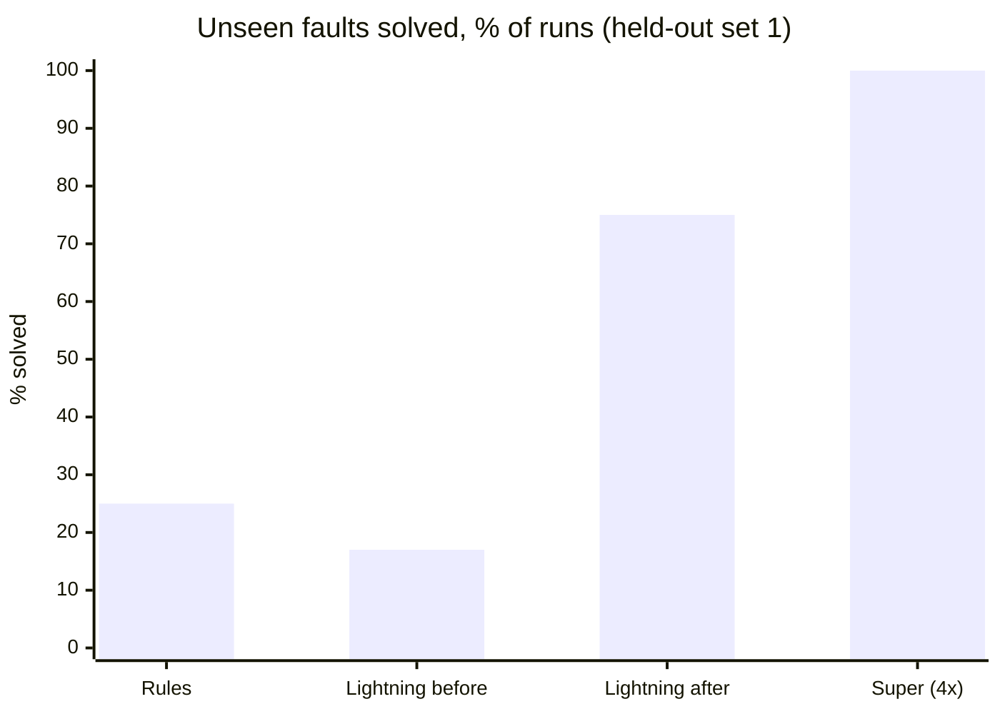
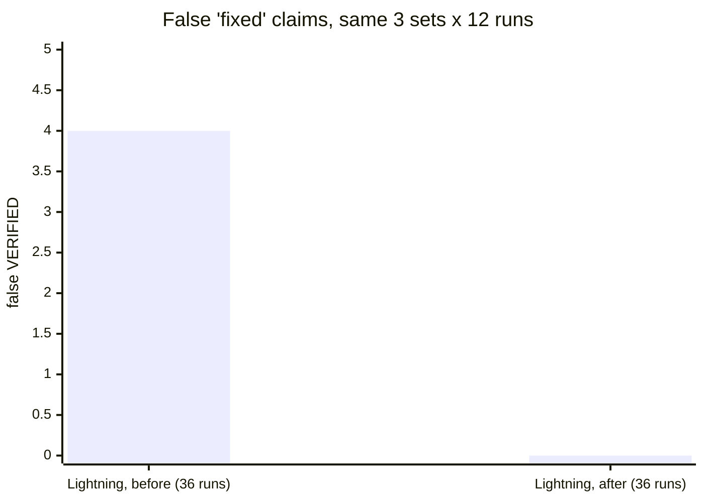
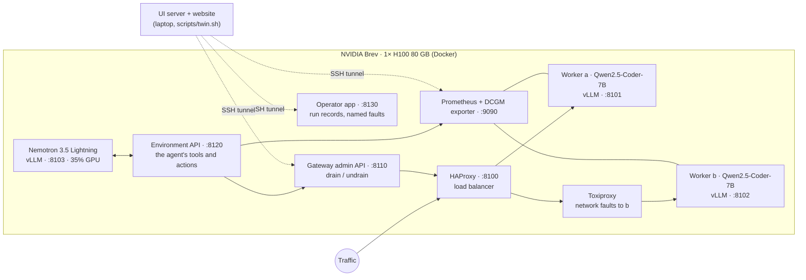
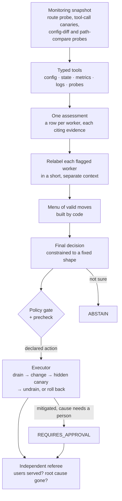

# Nexus Ω

**We made a small model trustworthy enough to touch production.**

Nexus Ω repairs self-hosted AI inference. A 3B-active NVIDIA Nemotron 3.5 Lightning agent investigates a live vLLM fleet through typed tools and proposes one fix. Code checks the fix and applies it with an undo path. A referee the model can't influence decides whether it worked. The model never grades its own work.

> **0** false "fixed" claims in 36 runs · **9/12 vs 3/12** for hand-written rules on faults nobody wrote rules for · tool calling **0.83 → 0.00** under a silent fault that every health check misses

NVIDIA × Red Hat Small Models Hack, Raleigh, October 17–18, 2026 · **Track: Tool-Calling** · Bounties: **Best use of Nemotron Lightning**, **Best use of Red Hat vLLM**

**Contents:** [In 30 seconds](#in-30-seconds) · [Results](#results) · [Tech stack & architecture](#tech-stack--architecture) · [Quick start](#quick-start) · [Reproduce the demo](#reproduce-the-demo) · [Datasets & provenance](#datasets-synthetic-data--provenance) · [Limitations & next steps](#known-limitations) · [For the judges](#for-the-judges) · [Team](#team)

---

## In 30 seconds

**The problem.**
- Teams run their own models on vLLM to power AI agents.
- One wrong serving setting, such as a tool parser that doesn't match the model, and the server keeps answering HTTP 200. It stays fast, every health check stays green, and the tool calls the agents depend on are silently gone.
- We measured it: the tool-calling score of the same model on the same GPU drops from 0.83 to 0.00, and no alert fires.

**What we built.**
- A real two-worker vLLM fleet on one NVIDIA Brev H100. We break it on purpose: dropped tool calls, killed workers, slow or cut network links, a worker choked under load.
- On the same GPU, Nemotron 3.5 Lightning looks around through typed tools and proposes one fix.
- A policy gate checks the fix, an executor applies it and can undo it, and an independent referee decides whether users are served and the root cause is gone.

**What we found.**
- Out of the box, the small model sometimes said "fixed" when nothing was: 3 times in its first 12 runs, 4 times across 36.
- We didn't swap in a bigger model. We redesigned the harness around the same weights, and across 36 new runs it made **zero** false "fixed" claims.
- On faults nobody wrote rules for, it now solves **9 of 12** where hand-written rules solve 3.
- A model with 4× the active parameters, on the same harness, solves 11 of 11. But it takes about twice as long and runs on a hosted endpoint instead of the GPU it repairs.

## Results

Every number below is rebuilt from the records in [`evidence/`](evidence/) by the code that serves the website ([`nexus/results/store.py`](nexus/results/store.py), run sets named in [`evidence/batches.json`](evidence/batches.json)). The full log, including every failed attempt, is in [`evidence/agent/README.md`](evidence/agent/README.md).

### Faults nobody wrote rules for (held-out set 1)



Rules 3/12 · Lightning before 2/12 · **Lightning after 9/12** · Super 11/11 valid (a reference run, not part of the product).

### False "fixed" claims: the number that matters

A smoke detector that sometimes misses a fire is a problem. One that says the fire is out while the kitchen is still burning is far worse, because everyone stops looking. That's a **false VERIFIED**: the agent claims a repair worked and the referee finds it didn't.



### Every fault, every run

One icon per run, as the referee scored it: ✅ solved · ⬜ honest miss (no false claim) · ❌ false "fixed" · `·` not run.

| Fault | Rules | Lightning before | Lightning after | Super 120B (ref) |
|---|---|---|---|---|
| **Faults we wrote rules for** | | | | |
| Tool calls silently dropped (wrong parser, vLLM #32926) <br><sub>`vllm-32926`</sub> | ✅✅✅ | ✅✅✅ | ✅✅✅ | · |
| Slow network link to a worker <br><sub>`net-latency-b`</sub> | ✅✅✅ | ✅❌❌ | ✅✅✅ | · |
| Network link to a worker cut <br><sub>`net-blackhole-b`</sub> | ✅✅✅ | ✅❌✅ | ✅✅✅ | · |
| Worker killed <br><sub>`kill-b`</sub> | ✅✅✅ | ⬜⬜✅ | ⬜✅✅ | · |
| *Total* | *12/12* | *7/12* | ***11/12*** | · |
| **New faults, set 1 (held-out v1)** | | | | |
| Two faults at once (slow link + dropped tool calls) <br><sub>`compound-latb-32926a`</sub> | ⬜⬜⬜ | ⬜⬜⬜ | ✅⬜✅ | ✅✅ |
| Worker choked under load <br><sub>`capacity-b`</sub> | ⬜⬜⬜ | ⬜⬜⬜ | ⬜⬜✅ | ✅✅✅ |
| Tools silently ignored (template drops them) <br><sub>`tools-stripped-a`</sub> | ⬜⬜⬜ | ⬜⬜✅ | ✅✅✅ | ✅✅✅ |
| Nothing wrong (right answer: change nothing) <br><sub>`noop`</sub> | ✅✅✅ | ❌✅⬜ | ✅✅✅ | ✅✅✅ |
| *Total* | *3/12* | *2/12* | ***9/12*** | *11/11* |
| **New faults, set 2 (held-out v2)** | | | | |
| Tool calling switched off (HTTP 400) <br><sub>`noauto-a`</sub> | ✅✅✅ | ✅✅✅ | ✅✅✅ | · |
| Tool calls dropped, other worker <br><sub>`vllm-32926-b`</sub> | ✅✅✅ | ✅✅✅ | ✅✅✅ | · |
| Other worker killed <br><sub>`kill-a`</sub> | ✅✅✅ | ⬜✅⬜ | ✅✅✅ | · |
| Crash plus dropped tool calls <br><sub>`compound-killb-32926a`</sub> | ✅✅✅ | ✅✅✅ | ✅✅✅ | · |
| *Total* | *12/12* | *10/12* | ***12/12*** | · |

How to read it:
- The rules are perfect on the faults they were written for, and fall apart on new ones.
- The redesigned agent is right on 32 of 36 runs. All 4 misses ended in REQUIRES_APPROVAL: it handed the problem to a person instead of claiming a fix, though in each case its own first move (draining a worker) had been the wrong one.

### Would a bigger model do better?

Same structured harness, fleet and referee on held-out set 1; only the model endpoint changes.

| | Nemotron 3.5 Lightning | Nemotron 3 Super |
|---|---|---|
| Size | 30B total · **3B active** | 120B total · 12B active |
| Unseen faults solved | 9/12 | 11/11 valid |
| False "fixed" claims | **0** | **0** |
| Median time per incident | **95 s** | 202 s (includes hosted-API network time) |
| Where it runs | On the same H100 as the fleet it repairs, 35% of its memory | Hosted API, off the box |

**Reading.** The harness took Lightning from 2/12 to 9/12; the bigger model adds the last two. Lightning missed 3 runs on that set:
- **capacity-b, ×2:** its first draft named the right cause (a concurrency cap), but the separate relabel step changed the label to "overloaded", for which only a drain is offered.
- **compound, ×1:** it drained worker b before repairing worker a, despite the menu's note on the order, and then a couldn't be repaired without an outage.

4 of Super's 15 records are excluded, all for harness reasons. Each is listed with its reason in `evidence/batches.json`:
- one hit the old 120 s run cap;
- one ran the old free-form harness;
- one started with a worker already drained;
- one hit a hosted-API read timeout.

**Is it luck?** A temperature 0.6 rerun on a 4-fault subset gives the same total (9/12, 0 false claims) with a different spread. At 3 runs per fault that's within noise, so temperature 0 stays the default.

### Why it matters: tool calling under each serving setup

BFCL ([Berkeley Function-Calling Leaderboard](https://github.com/gorilla-llm/gorilla/tree/main/berkeley-function-call-leaderboard)): 200 pinned cases, gorilla `6ea5797`, on worker a. Only the serving profile changes.

| Serving setup | simple | multiple | parallel | Tool-calling score |
|---|---|---|---|---|
| Healthy (the repair) | 46/50 | 45/50 | 33/50 | **0.83** |
| Wrong tool parser (vLLM #32926) | 0/50 | 0/50 | 0/50 | **0.00** |
| Chat template drops the tools | 0/50 | 0/50 | 0/50 | **0.00** |

The two broken setups answered all 400 of their requests with no HTTP errors. Users lose all tool calling and nothing alerts. The one-step repair restores 0.83.

### Plain terms

| Term | What it means |
|---|---|
| **Referee** | Code outside the model's control ([`nexus/eval/episode.py`](nexus/eval/episode.py)). After every incident it sends real traffic through the load balancer plus hidden test prompts to the faulty worker. It decides whether users are served *and* the root cause is gone. |
| **Held-out faults** | Built after the agent and the rules were frozen; neither was written or tuned against them. |
| **False VERIFIED** | The agent says "fixed, verified" and the referee disagrees. |
| **REQUIRES_APPROVAL** | The agent applied what it safely could (for example, draining a worker behind a bad network link) and hands the cause to a person. It counts as solved when that's the right call. |
| **ABSTAIN** | The agent changed nothing. Right when nothing is wrong; an honest miss otherwise. |

## Tech stack & architecture

### What runs where



### The repair loop



1. **Notice.** The trigger is a snapshot taken through the environment API: a probe through the load balancer, a tool-call canary on each worker, and probes that compare each worker's configuration with the reviewed one. There's no hint about which fault was injected.
2. **Look around.** Lightning calls typed, read-only tools declared in a manifest: configuration, state, metrics (Prometheus), logs, probes ([`apps/environment/`](apps/environment/), [`nexus/tools/environment.py`](nexus/tools/environment.py)). A malformed tool call goes back to it as an error instead of ending the run.
3. **Assess, relabel, choose.** These run in code ([`nexus/agent/structured.py`](nexus/agent/structured.py)):
   - One constrained call returns a row per worker, each citing evidence IDs from this run.
   - Each flagged worker is then relabelled from its own finding in a short, separate context.
   - Lightning picks from a menu of valid moves that code builds from the manifest.
   - The final answers are constrained to a JSON schema (vLLM `response_format`) with thinking off.
4. **Gate.** Only declared actions pass the policy gate ([`nexus/agent/policy.py`](nexus/agent/policy.py)): apply a reviewed serving profile, drain, restart, or undrain (approval needed). Applying needs an executor token the model never sees. Fault injection lives behind the operator app's own token ([`apps/operator/main.py`](apps/operator/main.py)).
5. **Act, with an undo.** For a serving-profile change, the executor drains the worker, applies the change, runs a hidden canary, and undrains or rolls back ([`nexus/harness/executor.py`](nexus/harness/executor.py)). A restart relaunches the worker and checks it. A drain takes the worker out of rotation and leaves the cause for a person.
6. **Referee.** Independent of the agent, it scores every episode ([`nexus/eval/episode.py`](nexus/eval/episode.py)).

It isn't a fixed script. Different faults lead to different probe paths and end states:
- apply a profile to worker a or b;
- relaunch a killed worker;
- drain a worker behind a bad link and hand the cause to a person;
- do nothing when nothing is wrong.

### What we used, and why

| Component | Why we chose it | Where |
|---|---|---|
| **NVIDIA** | | |
| Nemotron 3.5 Lightning (30B total, 3B active, NVFP4) | The agent and the only generative model in the product. Small enough to run beside the fleet it repairs (35% of the GPU), fast enough for a tool loop. `qwen3_coder` tool parser, `nemotron_v3` reasoning parser | [`runtime/profiles/lightning-nvfp4.agent.json`](runtime/profiles/lightning-nvfp4.agent.json), [`nexus/infrastructure/nemotron.py`](nexus/infrastructure/nemotron.py) |
| NVIDIA Brev, 1× H100 80 GB | One host for the agent, both workers and the telemetry | [`docs/brev.md`](docs/brev.md) |
| NVIDIA DCGM exporter | GPU utilization, power and temperature in the website's live view | [`runtime/compose/docker-compose.yml`](runtime/compose/docker-compose.yml), [`apps/twin/live.py`](apps/twin/live.py) |
| **vLLM** | | |
| vLLM v0.27.1 (`vllm/vllm-openai`) | Serves the agent *and* the fleet it repairs: it is both host and patient | [`nexus/target/manager.py`](nexus/target/manager.py) |
| Serving profiles, parser plugin, chat templates | The thing that breaks and gets repaired: versioned profiles, the matched Qwen2.5-Coder parser plugin and template (PR #32931) | [`runtime/profiles/`](runtime/profiles/), [`runtime/plugins/`](runtime/plugins/), [`runtime/templates/`](runtime/templates/) |
| **Fleet & faults** | | |
| Docker, Docker Compose | Workers and the agent run as `docker run` containers; Compose runs the shared services | [`nexus/target/manager.py`](nexus/target/manager.py), [`scripts/bring_up.sh`](scripts/bring_up.sh) |
| HAProxy 3.0 | Load balancer in front of both workers; drain and undrain through its runtime API without dropping the other worker | [`runtime/compose/haproxy.cfg`](runtime/compose/haproxy.cfg), [`apps/gateway/`](apps/gateway/) |
| FastAPI | The gateway admin API, the agent's environment API, the operator app, the UI server | [`apps/`](apps/) |
| Prometheus | Latency, queue and KV-cache metrics behind the agent's `query_metrics` tool | [`runtime/compose/prometheus.yml`](runtime/compose/prometheus.yml), [`apps/environment/main.py`](apps/environment/main.py) |
| Toxiproxy | Real network faults (latency, blackhole) on the path to worker b | [`nexus/faults/network.py`](nexus/faults/network.py) |
| Process and load faults | Kill a worker; drive steady load at a worker capped to one sequence | [`nexus/faults/process.py`](nexus/faults/process.py), [`nexus/faults/load.py`](nexus/faults/load.py) |
| **Evaluation** | | |
| Episodes and referee | Reset, inject, solve, score; the same for every solver | [`nexus/eval/episode.py`](nexus/eval/episode.py) |
| Rule baseline | Hand-written rules from the same snapshot, the bar the agent has to beat | [`nexus/baseline/rules.py`](nexus/baseline/rules.py) |
| BFCL harness | Measures tool calling per serving profile | [`nexus/verifier/bfcl.py`](nexus/verifier/bfcl.py), [`scripts/bfcl_arms.sh`](scripts/bfcl_arms.sh) |
| guidellm 0.8.0 | Concurrency sweeps behind the capacity numbers | [`scripts/load_sweep.sh`](scripts/load_sweep.sh), [`runtime/load/Dockerfile`](runtime/load/Dockerfile) |
| **Website** | | |
| React, three.js, Vite, Tailwind, framer-motion | Landing page, results charts, 3D replay of recorded runs, Break it live | [`apps/web/`](apps/web/) |
| SimPy | Only the platform page's datacenter "what if" scene, labelled simulated | [`nexus/simulator/`](nexus/simulator/) |

## Quick start

**Prerequisites.**
- **Results website (any laptop):** [`uv`](https://docs.astral.sh/uv/) and Node 20+.
- **The fleet:** a Linux host with one 80 GB NVIDIA GPU, Docker with the NVIDIA container runtime, Python 3.11, and a Hugging Face token.

**1. See the results offline (no GPU).** The website reads the committed `evidence/` when no box is configured.

```bash
./scripts/twin.sh            # creates .venv (Python 3.13 via uv), builds apps/web once, serves http://127.0.0.1:8765
```

Open these pages:

| Page | What's there |
|---|---|
| `/` | Landing page with a 3D replay of a real run |
| `/results.html` | Every chart and run |
| `/story.html?run=run-ce0c86a3` | One recorded repair, step by step |
| `/about.html` | The project in plain language |
| `/platform.html` | Simulated datacenter scene |

For UI development, run `cd apps/web && npm ci && npm run dev`; Vite proxies `/api` to :8765.

**2. Bring up the fleet (GPU host).** Run from the repo root with your Python 3.11 venv active. The box scripts read `PYTHON=` (default `/ephemeral/venvs/nexus/bin/python`, the Brev layout in [`docs/brev.md`](docs/brev.md)).

```bash
cp .env.example .env                       # set HF_TOKEN, HF_HOME and NEXUS_ADMIN_TOKEN (openssl rand -hex 16)
./scripts/bring_up.sh                      # HAProxy, gateway, Prometheus, DCGM, Toxiproxy + workers a and b
python -m nexus.target.manager up agent lightning-nvfp4.agent --port 8103   # Nemotron 3.5 Lightning
PYTHON=$(which python) ./scripts/environment_up.sh   # the agent's API on :8120 (adds its two tokens to .env)
PYTHON=$(which python) ./scripts/operator_up.sh      # run records and named faults on :8130 (adds its token)
```

**3. Run an episode: inject a fault, let a solver work, score it.**

```bash
set -a; . ./.env; set +a
python -m nexus.eval.episode tools-stripped-a --solver agent           # one fault
python -m nexus.eval.episode heldout --solver agent --repeat 3          # a set: all | heldout | heldout2
python -m nexus.eval.episode heldout --solver rules --repeat 3          # the rule baseline
```

Records land in `artifacts/` on the box; the committed copies are in `evidence/`.

**Tests:** `python -m unittest discover -s tests` (130 tests).

## Reproduce the demo

**Configuration.** Copy [`.env.example`](.env.example) to `.env` on the GPU host.

| Variable | Needed for | How to get it |
|---|---|---|
| `HF_TOKEN` | Model downloads (Lightning, Qwen2.5-Coder-7B) | Your Hugging Face read token |
| `NEXUS_ADMIN_TOKEN` | Drain/undrain through the gateway | `openssl rand -hex 16` |
| `NEMOTRON_BASE_URL`, `NEMOTRON_MODEL` | The agent's endpoint | Defaults point at the local agent (`:8103`, `nemotron-lightning`) |
| `NEMOTRON_API_KEY` | Only for a hosted endpoint (how we ran Nemotron 3 Super) | build.nvidia.com key |
| `NEXUS_ENVIRONMENT_API_KEY`, `NEXUS_EXECUTOR_TOKEN` | The agent's API and the executor | Generated by `scripts/environment_up.sh` |
| `NEXUS_OPERATOR_TOKEN` | Named faults and run records | Generated by `scripts/operator_up.sh` |

The sample `.env` (abridged):

```bash
HF_TOKEN=hf_...
NEXUS_VLLM_IMAGE=vllm/vllm-openai:v0.27.1
NEXUS_ADMIN_TOKEN=<openssl rand -hex 16>
NEMOTRON_BASE_URL=http://127.0.0.1:8103/v1
NEMOTRON_MODEL=nemotron-lightning
NEMOTRON_TEMPERATURE=0
NEXUS_ENVIRONMENT_URL=http://127.0.0.1:8120
```

**The demo, step by step.**
1. Bring up the fleet (Quick start, step 2).
2. On your laptop, tunnel the box and start the UI server in live mode. These variables go in the laptop shell, not the box `.env`.

   ```bash
   ssh -N -L 8110:localhost:8110 -L 8130:localhost:8130 -L 9090:localhost:9090 <gpu-host> &
   export NEXUS_OPERATOR_URL=http://127.0.0.1:8130 NEXUS_OPERATOR_TOKEN=<box .env> \
          NEXUS_GATEWAY_URL=http://127.0.0.1:8110 NEXUS_ADMIN_TOKEN=<box .env> \
          NEXUS_PROMETHEUS_URL=http://127.0.0.1:9090
   ./scripts/twin.sh
   ```

3. Open `http://127.0.0.1:8765/story.html` and press **Break it live**. It appears only while the operator app answers.
4. Pick a fault. The live column shows the dashboards staying green while the canary fails, then Lightning's steps, the executor's repair and the referee's verdict.
5. When the run ends, it plays back as a step-by-step replay.
6. Open `/results.html` for every set, every run and the bigger-model comparison.

Without a GPU, steps 3–6 still work on recorded runs: `/story.html?run=<run-id>` replays any run listed on the results page.

## Datasets, synthetic data & provenance

| Source | License | How we use it |
|---|---|---|
| [BFCL](https://github.com/gorilla-llm/gorilla/tree/main/berkeley-function-call-leaderboard), gorilla commit `6ea5797` | Apache-2.0 | 200 pinned cases that score tool calling per serving setup ([`evidence/bfcl/`](evidence/bfcl/)) |
| [vLLM](https://github.com/vllm-project/vllm) issue #32926 and PR #32931 | Apache-2.0 | The silent parser fault, and the matched parser plugin and template that repair it |
| [Nemotron 3.5 Lightning NVFP4](https://huggingface.co/nvidia/NVIDIA-Nemotron-3.5-Lightning-30B-A3B-NVFP4) | [OpenMDW 1.1](https://openmdw.ai/license/1-1/) | The agent |
| [Qwen2.5-Coder-7B-Instruct](https://huggingface.co/Qwen/Qwen2.5-Coder-7B-Instruct) @ `c03e6d3` | Apache-2.0 | The fleet's workers |
| Nemotron 3 Super 120B-A12B (NVIDIA hosted API) | NVIDIA API terms | One comparison run only; not part of the product |

**Synthetic data we made, and where it lives:**
- **Faults:** 12 named faults injected from a clean reset into the real fleet ([`nexus/eval/episode.py`](nexus/eval/episode.py) `FAULTS`, [`runtime/profiles/`](runtime/profiles/), [`nexus/faults/`](nexus/faults/)).
- **Load:** synthetic requests for the capacity sweeps (guidellm, 256 tokens in / 128 out) and the overload fault ([`nexus/faults/load.py`](nexus/faults/load.py)).
- **Hidden canaries:** tool-call test prompts the agent never sees, used by the executor and the referee ([`runtime/canaries/hidden.jsonl`](runtime/canaries/hidden.jsonl)).
- **Every episode record and run trail** behind the results: [`evidence/`](evidence/), 159 episodes, with a guide in [`evidence/README.md`](evidence/README.md).

## How we evaluated

- **Episodes.** Each episode resets the fleet, injects one named fault, lets a solver work, and scores the result with the referee. Each fault ran 3 times per solver.
- **Baseline.** Hand-written rules, starting from the same probes.
- **Held-out sets.** Built after the solvers were frozen. Neither the rules nor the agent was edited for set 1. Set 2 was written before the redesign, but development builds touched half of it.
- **Fairness.** Worker profile names are hidden from the agent, because the broken profile's name gives the fault away.
- **Same weights.** Before and after use the same model, fleet, faults and referee. Only the harness changed.
- **Reporting.** Every run is shown, including failures and excluded runs with their reasons. We make no significance claims on a small benchmark.

## Known limitations

- **Single host:** one H100, two workers, one model family as the patient.
- **Small samples:** 3 runs per fault per solver.
- **Capacity faults are Lightning's weakest:** 1/3 on "worker choked under load", because the relabel step overrides a correct draft.
- **Set 2 isn't fully blind:** two of its faults are label swaps of known faults, and development builds touched half of it.
- **Rollback is wired but untested in practice:** it was never needed in 159 episodes.
- **We ran upstream vLLM** (`vllm/vllm-openai:v0.27.1`), not a Red Hat build.
- **The website has two kinds of scene:** the 3D replay uses one scene for recorded runs and illustrative stories, and the platform page's datacenter is a SimPy illustration. Both are labelled simulated where they aren't real runs.

## Next steps

- **Fix the capacity miss:** relabel only when the first draft contradicts the evidence, never override a specific, valid cause.
- **Harder hidden checks:** add held-out BFCL cases to the hidden canaries.
- **Exercise rollback:** add a fault whose first fix fails, so a rollback happens on record.
- **Scale up:** more workers, more fault types (hung worker, noisy neighbour), more model families.
- **Red Hat build:** run the fleet on the Red Hat AI Inference Server image of vLLM.

## For the judges

| Criterion | What we did | Where to see it |
|---|---|---|
| **Technical Execution & Completeness**: end to end, open data, robust tool calling that recovers instead of following a hardcoded sequence | A live fleet on real hardware with faults injected from clean resets, and 159 recorded episodes. Typed tools, evidence citations, constrained decisions, a policy gate, an executor with rollback, and an independent referee. Different faults lead to different paths and end states. 130 automated tests. | [Results](#results), `evidence/agent/runs/` (every run's full trail), the website's replay, `tests/` |
| **NVIDIA & Red Hat Ecosystem Utility**: meaningful use, a reason for each choice | Lightning is the agent because 3B active lets it share the patient's GPU. vLLM is both host and patient, configured down to parsers, templates and a parser plugin. Brev hosts everything; DCGM feeds the live view. | [Lightning](#best-use-of-nemotron-lightning), [vLLM](#best-use-of-red-hat-vllm), [What we used](#what-we-used-and-why) |
| **Value & Impact**: a specific problem, usable soon | Silent tool-calling failure on self-hosted vLLM: HTTP 200, health checks green, tool calling 0.83 → 0.00. The users are platform and MLOps teams self-hosting open models. | [BFCL](#why-it-matters-tool-calling-under-each-serving-setup), the website's landing page |
| **Innovation & Execution**: a novel combination, optimized | It goes from diagnosis to *verified* repair, not just detection, and the model never grades itself. The headline metric is false "fixed" claims, cut from 4 to 0 with the same weights. It is checked against rules, a temperature ablation and a 4× larger model. | [Results](#results), [`evidence/agent/README.md`](evidence/agent/README.md) |

### Best use of Nemotron Lightning

**What it does.** Lightning is the agent. It reads the fleet through typed tools, cites evidence for every claim, and either proposes one declared action or abstains. It runs on vLLM on the same H100 as the two workers it repairs.

**Why Lightning.**
- An ops agent has to sit next to its patient: when the network or the cluster is what's broken, a remote model is the first thing you lose.
- With 3B active parameters in NVFP4, Lightning fits beside the fleet in 35% of the GPU's memory.
- Its diagnosis takes about 14 s of an incident; most of the rest is restarting a worker and verifying it.
- We measured the alternative: Nemotron 3 Super, with 4× the active parameters, scores 11/11 on the same harness, takes about twice as long, and needs a hosted endpoint.

**How we optimized it.** We kept the weights fixed and rebuilt the harness in four builds, each fixing one failure we saw in live runs ([build log](evidence/agent/README.md)):
1. **Code runs the workflow.** One constrained assessment of every worker, then a choice from a menu of valid moves that code builds; code writes the final decision.
2. **Compare with the reviewed configuration.** Probes compare each worker with the reviewed config instead of with each other.
3. **Hold labels to the evidence.** Probes flag abnormal workers, and code rejects a "healthy" label that contradicts a flag.
4. **Relabel in a short context.** Each flagged worker is relabelled from its own finding alone, which fixed findings that were right but labelled wrong.

Underneath all four:
- Decisions are constrained by vLLM `response_format` to a schema that only accepts this run's evidence IDs, with thinking off.
- Malformed tool calls go back to the model as errors.
- Profile names are hidden.

**Result.** Build 4, scored on every set:

| Set | Before | After (build 4) |
|---|---|---|
| Held-out v1 | 2/12 | **9/12** (rules 3/12) |
| Held-out v2 | 10/12 | **12/12** |
| Known faults | 7/12 | **11/12** |
| False "fixed" claims, 36 runs | 4 | **0** |

At temperature 0.6 instead of 0, the total is the same.

### Best use of Red Hat vLLM

vLLM is both the host and the patient here.

**The agent.**
- Lightning NVFP4 on vLLM v0.27.1, with the `qwen3_coder` tool parser, the `nemotron_v3` reasoning parser and the Lightning recipe flags (Mamba cache settings, prefix caching, async scheduling).
- Capped at 64 concurrent sequences, so it fits in 35% of the GPU's memory.

**The patient.** Two Qwen2.5-Coder-7B workers. Their serving profile is the thing that breaks and gets repaired:
- The broken profile uses the `hermes` parser, which this model doesn't follow ([vLLM #32926](https://github.com/vllm-project/vllm/issues/32926)): HTTP 200, no tool calls.
- The repair is a matched parser plugin plus chat template (from PR #32931).
- Profiles are versioned JSON, and the model revision is pinned.

**Measured serving** (guidellm, 256 tokens in / 128 out, successful requests per second):

| Setup | Peak req/s | What limits it |
|---|---|---|
| 1 replica, direct | 42.5 | GPU compute |
| 2 replicas, our first Python gateway | 29.6 | the gateway saturated one CPU core |
| 2 replicas, HAProxy | 36.1 | the shared GPU |

We replaced our Python gateway with HAProxy because of this sweep. On one GPU, the second replica buys fault isolation (one can be drained while the other serves), not throughput.

**Fault effect, measured:** injected latency on worker b's link moves its p95 from 0.04 s to 1.7 s while worker a is unaffected.

## Repo map

```text
nexus/agent/        Agent loop: tools, evidence, structured decisions, policy, budgets
nexus/harness/      Agent runner and executor (drain → change → canary → undrain / roll back)
nexus/eval/         Episodes: reset, inject, solve, referee
nexus/baseline/     Hand-written rule baseline
nexus/target/       vLLM worker manager
nexus/faults/       Fault injection: process, network, load
nexus/verifier/     Canaries, route probe, BFCL, SLO checks
nexus/results/      Reads run records and builds the scoreboard (website + operator app)
nexus/simulator/, nexus/doctors/, nexus/certificate/
                    SimPy model and rule-based stand-ins behind the platform page's simulated scene
nexus/evaluation/, scenarios/
                    Side experiment on vLLM issue scenarios; not part of the scored results
apps/environment/   The agent's environment API (manifest, tools, actions)
apps/gateway/       Admin API over HAProxy
apps/operator/      Box app: run records and named faults for Break it live
apps/twin/          UI server: results API, live stream, Break it passthrough
apps/web/           Website: landing, results, about, 3D replay, platform
runtime/            vLLM profiles, parser plugin, templates, compose, canaries, load image
evidence/           Every recorded episode, run trail, BFCL run and sweep
scripts/            Bring-up, gates, sweeps, BFCL
tests/              130 tests
```

## Team

Samarth Shah · Adit Shah · Khush Patel

The work split three ways:
- **Agent & evaluation:** Nemotron serving and controller, the structured harness, the evaluation.
- **Live fleet & incidents:** the Brev host, vLLM bring-up, HAProxy and gateway, telemetry, faults, executor, referee, BFCL, sweeps.
- **Website & simulation:** landing, results, 3D replay, Break it live, the platform scene.

## License

[Apache-2.0](LICENSE). Upstream models, datasets and fixtures keep their own licenses (see [Datasets & provenance](#datasets-synthetic-data--provenance)).
